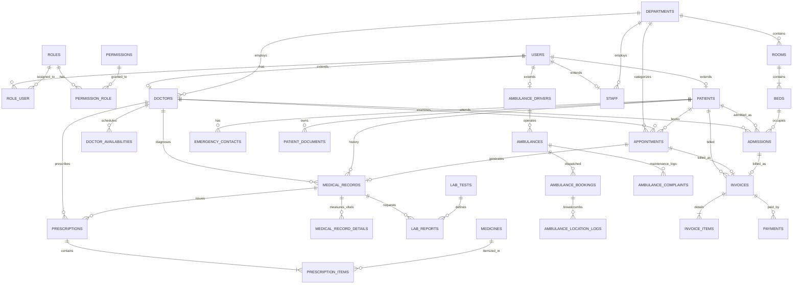

# 🏛️ Apex Horizon Healthcare System: Models, Entity Relations & 3NF Normalization Analysis

This document provides an exhaustive, production-grade reference for all **Eloquent Models** and **Database Tables** within the **Apex Horizon Medical Center** platform. It details the purpose of each table, maps all foreign-key relationships and cardinalities, and provides a formal mathematical and architectural proof of why this database architecture complies with **Third Normal Form (3NF)**.

---

## 📑 Table of Contents
1. [System Architectural Overview](#1-system-architectural-overview)
2. [Domain-by-Domain Model Directory & Table Purposes](#2-domain-by-domain-model-directory--table-purposes)
   - [2.1 Identity, Access Control & RBAC](#21-identity-access-control--rbac)
   - [2.2 Hospital Organization & Healthcare Providers](#22-hospital-organization--healthcare-providers)
   - [2.3 Patient Dossier & Emergency Contacts](#23-patient-dossier--emergency-contacts)
   - [2.4 Outpatient Consultations & Clinical EMR](#24-outpatient-consultations--clinical-emr)
   - [2.5 Pharmacy, Medication & Inventory](#25-pharmacy-medication--inventory)
   - [2.6 Diagnostic Laboratory & Pathology](#26-diagnostic-laboratory--pathology)
   - [2.7 Inpatient Facilities & Bed ADT](#27-inpatient-facilities--bed-adt)
   - [2.8 Emergency Ambulance Fleet & GPS Tracking](#28-emergency-ambulance-fleet--gps-tracking)
   - [2.9 Financial Billing, Invoicing & Contactless Payments](#29-financial-billing-invoicing--contactless-payments)
   - [2.10 System Governance & Communication](#210-system-governance--communication)
3. [Master Relationship Matrix (Foreign Keys & Cardinality)](#3-master-relationship-matrix-foreign-keys--cardinality)
4. [Complete Entity-Relationship Diagram (Mermaid ERD)](#4-complete-entity-relationship-diagram-mermaid-erd)
5. [Comprehensive Proof: Why this Schema is in 3NF](#5-comprehensive-proof-why-this-schema-is-in-3nf)
   - [5.1 First Normal Form (1NF) Compliance](#51-first-normal-form-1nf-compliance)
   - [5.2 Second Normal Form (2NF) Compliance](#52-second-normal-form-2nf-compliance)
   - [5.3 Third Normal Form (3NF) Compliance & Transitive Dependency Elimination](#53-third-normal-form-3nf-compliance--transitive-dependency-elimination)
   - [5.4 Financial Immutability vs. Redundancy (The Snapshot Pricing Principle)](#54-financial-immutability-vs-redundancy-the-snapshot-pricing-principle)
   - [5.5 Anomaly Prevention (Insert, Update, Delete)](#55-anomaly-prevention-insert-update-delete)

---

## 1. System Architectural Overview

The database is built on relational RDBMS principles (MySQL/MariaDB) managed through Laravel 11 Eloquent ORM migrations. The schema separates core system identity from specialized clinical, administrative, and operational profiles using an **Entity Extension Pattern** (Table Inheritance), maintaining clear bounded contexts.

* **Total Database Tables**: 32 core domain tables (+ system cache/sessions/tokens tables)
* **Total Eloquent Models**: 34 models
* **Design Paradigm**: Fully normalized relational schema with isolated lookup domains, atomic transaction line items, and temporal event breadcrumbs.

---

## 2. Domain-by-Domain Model Directory & Table Purposes

### 2.1 Identity, Access Control & RBAC

| Model | Table Name | Purpose | Primary Key |
| :--- | :--- | :--- | :--- |
| **`User`** | `users` | Stores system authentication credentials, primary email, hashed password, account status, and username for all individuals. | `id` (BIGINT) |
| **`Role`** | `roles` | Defines authorization tiers (`superadmin`, `admin`, `doctor`, `staff`, `driver`, `patient`). | `id` (INT) |
| **`Permission`** | `permissions` | Granular permission capabilities and slugs for fine-grained capability checks. | `id` (INT) |
| *Pivot* | `role_user` | Many-to-many junction table assigning roles to users. | Composite `(user_id, role_id)` |
| *Pivot* | `permission_role` | Many-to-many junction table assigning permissions to roles. | Composite `(permission_id, role_id)` |

---

### 2.2 Hospital Organization & Healthcare Providers

| Model | Table Name | Purpose | Primary Key |
| :--- | :--- | :--- | :--- |
| **`Department`** | `departments` | Master catalog of hospital clinical and administrative departments (Cardiology, Emergency, Neurology, etc.). | `id` (INT) |
| **`Doctor`** | `doctors` | Specialized profile extension for physicians, holding license numbers, medical specialization, bio, consultation fee, and departmental assignment. | `id` (INT) |
| **`DoctorAvailability`** | `doctor_availabilities` | Weekly scheduling matrix defining work days (`Monday`-`Sunday`), start times, and end times per doctor. | `id` (INT) |
| **`Staff`** | `staff` | Profile extension for non-physician medical staff (Nurses, Receptionists, Lab Techs, Pharmacists, Cashiers). | `id` (INT) |
| **`Manager`** | `managers` | Administrative department managers and operational supervisors. | `id` (INT) |

---

### 2.3 Patient Dossier & Emergency Contacts

| Model | Table Name | Purpose | Primary Key |
| :--- | :--- | :--- | :--- |
| **`Patient`** | `patients` | Master patient demographic and medical profile: Unique Patient Identifier (`patient_code`), date of birth, blood group, phone, and medical history. | `id` (BIGINT) |
| **`EmergencyContact`** | `emergency_contacts` | Next-of-kin and emergency contacts linked to a patient, specifying relationship and primary/alternate phone numbers. | `id` (BIGINT) |
| **`PatientDocument`** | `patient_documents` | Electronic file registry of uploaded patient documents (Insurance cards, IDs, historical imaging, external discharge summaries). | `id` (BIGINT) |

---

### 2.4 Outpatient Consultations & Clinical EMR

| Model | Table Name | Purpose | Primary Key |
| :--- | :--- | :--- | :--- |
| **`Appointment`** | `appointments` | Scheduled consultation sessions between a patient and a doctor, specifying date, time slot, clinical status (`scheduled`, `completed`, `cancelled`, `no_show`), and chief complaint. | `id` (BIGINT) |
| **`MedicalRecord`** | `medical_records` | Clinical encounter note authored by a physician containing encounter visit timestamp, final diagnosis, symptoms, and clinical progress notes. | `id` (BIGINT) |
| **`MedicalRecordDetail`** | `medical_record_details` | Normalized key-value ledger of clinical vital signs measured during the encounter (e.g., Blood Pressure, Heart Rate, SpO2, Temperature, Weight). | `id` (BIGINT) |

---

### 2.5 Pharmacy, Medication & Inventory

| Model | Table Name | Purpose | Primary Key |
| :--- | :--- | :--- | :--- |
| **`Medicine`** | `medicines` | Master pharmaceutical inventory: brand name, generic formulation, category, unit sale price, physical stock on hand, and reorder warning threshold. | `id` (INT) |
| **`Prescription`** | `prescriptions` | Official doctor-signed prescription order linked to a patient and encounter with issuance status (`active`, `dispensed`, `cancelled`). | `id` (BIGINT) |
| **`PrescriptionItem`** | `prescription_items` | Individual prescribed line item indicating exact medicine, dosage strength (e.g., 500mg), frequency, course duration, and quantity to dispense. | `id` (BIGINT) |

---

### 2.6 Diagnostic Laboratory & Pathology

| Model | Table Name | Purpose | Primary Key |
| :--- | :--- | :--- | :--- |
| **`LabTest`** | `lab_tests` | Master diagnostic test catalog: test title, unique code (e.g. `CBC`, `LIPID`), diagnostic description, and standard charge. | `id` (INT) |
| **`LabReport`** | `lab_reports` | Laboratory diagnostic order lifecycle (`requested`, `in_progress`, `completed`, `cancelled`), linking the patient, requesting physician, lab technician, findings summary, and optional PDF attachment. | `id` (BIGINT) |

---

### 2.7 Inpatient Facilities & Bed ADT

| Model | Table Name | Purpose | Primary Key |
| :--- | :--- | :--- | :--- |
| **`Room`** | `rooms` | Hospital room units categorized by type (`Emergency`, `ICU`, `Private`, `Semi-Private`, `General Ward`), assigned department, and daily stay rate. | `id` (INT) |
| **`Bed`** | `beds` | Individual physical beds inside a room, tracking real-time operational status (`available`, `occupied`, `cleaning`, `maintenance`). | `id` (INT) |
| **`Admission`** | `admissions` | Inpatient admission record (ADT) capturing admission date, assigned bed, attending doctor, discharge date, status (`admitted`, `discharged`, `transferred`), and clinical discharge notes. | `id` (BIGINT) |

---

### 2.8 Emergency Ambulance Fleet & GPS Tracking

| Model | Table Name | Purpose | Primary Key |
| :--- | :--- | :--- | :--- |
| **`AmbulanceDriver`** | `ambulance_drivers` | Certified driver profile with commercial license number, contact phone, and duty availability (`on_duty`, `off_duty`). | `id` (BIGINT) |
| **`Ambulance`** | `ambulances` | Emergency vehicle fleet registry: plate number, vehicle model, life-support category, assigned doctor, assigned driver, live coordinates, and status. | `id` (BIGINT) |
| **`AmbulanceBooking`** | `ambulance_bookings` | Emergency dispatch request with pickup GPS coordinates, caller contact, destination hospital department, and lifecycle stages (`requested`, `assigned`, `en_route`, `arrived`, `completed`). | `id` (BIGINT) |
| **`AmbulanceLocationLog`** | `ambulance_location_logs` | Historical breadcrumb tracking coordinates logged periodically during active dispatches for route rendering and telemetry simulation. | `id` (BIGINT) |
| **`AmbulanceComplaint`** | `ambulance_complaints` | Vehicle mechanical and medical equipment issue tickets submitted by drivers, tracked through maintenance states (`submitted`, `in_maintenance`, `resolved`). | `id` (BIGINT) |

---

### 2.9 Financial Billing, Invoicing & Contactless Payments

| Model | Table Name | Purpose | Primary Key |
| :--- | :--- | :--- | :--- |
| **`Invoice`** | `invoices` | Master billing ledger summarizing gross subtotal, discounts, healthcare tax (5%), net payable, due date, and payment status (`unpaid`, `checking`, `partially_paid`, `paid`, `cancelled`). | `id` (BIGINT) |
| **`InvoiceItem`** | `invoice_items` | Itemized financial breakdown (consultation charge, daily room fee, medication costs, diagnostic lab fees). | `id` (BIGINT) |
| **`Payment`** | `payments` | Financial transaction receipt: amount paid, payment channel (`cash`, `credit_card`, `upi`, `insurance`), transaction reference, status (`completed`, `pending`, `rejected`), and rejection reason. | `id` (BIGINT) |

---

### 2.10 System Governance & Communication

| Model | Table Name | Purpose | Primary Key |
| :--- | :--- | :--- | :--- |
| **`Notification`** | `notifications` | Role-targeted notifications for appointment updates, bed transfers, prescription readiness, lab reports, and billing verification. | `id` (BIGINT) |
| **`Message`** | `messages` | Peer-to-peer secure messaging system between staff, doctors, and patients. | `id` (BIGINT) |
| **`AuditLog`** | `audit_logs` | Immutable regulatory audit trail capturing all system events (`CREATE`, `UPDATE`, `DELETE`, `LOGIN`, `DISPENSE`, `TRANSFER`) with user ID, IP address, and timestamp. | `id` (BIGINT) |
| **`SystemSetting`** | `system_settings` | Dynamic key-value system configuration (hospital name, base coordinates, tax rates, operational toggles). | `id` (INT) |

---

## 3. Master Relationship Matrix (Foreign Keys & Cardinality)

| Model (Entity) | Related Model | Relationship Type | Foreign Key Column | Target Primary Key | On Delete Behavior |
| :--- | :--- | :--- | :--- | :--- | :--- |
| **User** | Role | `belongsToMany` | `role_user.user_id` | `roles.id` | Cascade |
| **User** | Doctor | `hasOne` | `doctors.user_id` | `users.id` | Cascade |
| **User** | Patient | `hasOne` | `patients.user_id` | `users.id` | Set Null |
| **User** | Staff | `hasOne` | `staff.user_id` | `users.id` | Cascade |
| **User** | AmbulanceDriver | `hasOne` | `ambulance_drivers.user_id` | `users.id` | Cascade |
| **Doctor** | Department | `belongsTo` | `doctors.department_id` | `departments.id` | Set Null |
| **Doctor** | DoctorAvailability | `hasMany` | `doctor_availabilities.doctor_id`| `doctors.id` | Cascade |
| **Doctor** | Appointment | `hasMany` | `appointments.doctor_id` | `doctors.id` | Cascade |
| **Patient** | EmergencyContact | `hasMany` | `emergency_contacts.patient_id` | `patients.id` | Cascade |
| **Patient** | PatientDocument | `hasMany` | `patient_documents.patient_id` | `patients.id` | Cascade |
| **Patient** | Appointment | `hasMany` | `appointments.patient_id` | `patients.id` | Cascade |
| **Appointment** | MedicalRecord | `hasOne` | `medical_records.appointment_id` | `appointments.id` | Set Null |
| **Appointment** | Invoice | `hasOne` | `invoices.appointment_id` | `appointments.id` | Set Null |
| **MedicalRecord** | MedicalRecordDetail | `hasMany` | `medical_record_details.medical_record_id` | `medical_records.id` | Cascade |
| **MedicalRecord** | Prescription | `hasMany` | `prescriptions.medical_record_id` | `medical_records.id` | Cascade |
| **MedicalRecord** | LabReport | `hasMany` | `lab_reports.medical_record_id` | `medical_records.id` | Cascade |
| **Prescription** | PrescriptionItem | `hasMany` | `prescription_items.prescription_id` | `prescriptions.id` | Cascade |
| **PrescriptionItem** | Medicine | `belongsTo` | `prescription_items.medicine_id` | `medicines.id` | Restrict |
| **LabReport** | LabTest | `belongsTo` | `lab_reports.lab_test_id` | `lab_tests.id` | Restrict |
| **Room** | Department | `belongsTo` | `rooms.department_id` | `departments.id` | Cascade |
| **Room** | Bed | `hasMany` | `beds.room_id` | `rooms.id` | Cascade |
| **Bed** | Admission | `hasMany` | `admissions.bed_id` | `beds.id` | Restrict |
| **Admission** | Patient | `belongsTo` | `admissions.patient_id` | `patients.id` | Cascade |
| **Admission** | Doctor | `belongsTo` | `admissions.doctor_id` | `doctors.id` | Cascade |
| **Admission** | Invoice | `hasOne` | `invoices.admission_id` | `admissions.id` | Set Null |
| **Ambulance** | AmbulanceDriver | `belongsTo` | `ambulances.current_driver_id` | `ambulance_drivers.id` | Set Null |
| **Ambulance** | Doctor | `belongsTo` | `ambulances.assigned_doctor_id` | `doctors.id` | Set Null |
| **Ambulance** | AmbulanceBooking | `hasMany` | `ambulance_bookings.ambulance_id` | `ambulances.id` | Cascade |
| **AmbulanceBooking** | AmbulanceLocationLog | `hasMany` | `ambulance_location_logs.booking_id` | `ambulance_bookings.id` | Set Null |
| **Ambulance** | AmbulanceComplaint | `hasMany` | `ambulance_complaints.ambulance_id` | `ambulances.id` | Cascade |
| **Invoice** | InvoiceItem | `hasMany` | `invoice_items.invoice_id` | `invoices.id` | Cascade |
| **Invoice** | Payment | `hasMany` | `payments.invoice_id` | `invoices.id` | Cascade |

---

## 4. Complete Entity-Relationship Diagram (Mermaid ERD)

---

## 5. Comprehensive Proof: Why this Schema is in 3NF

A relational database schema is in **Third Normal Form (3NF)** if and only if it satisfies three consecutive conditions:
1. It is in **First Normal Form (1NF)**.
2. It is in **Second Normal Form (2NF)**.
3. Every non-prime attribute is **non-transitively dependent** on every candidate key of the relation (no non-key attribute depends on another non-key attribute: $X \to Y$ only where $X$ is a superkey, or $Y$ is a prime attribute).

Below is the step-by-step mathematical and design proof across the entire application schema.

---

### 5.1 First Normal Form (1NF) Compliance

**Definition of 1NF:**
* All column values must be **atomic** (indivisible).
* Each row must be **unique** with a designated Primary Key.
* There are **no repeating groups** or variable array columns.

#### Proof for Apex Horizon Schema:
1. **Atomicity of Attributes**:
   - The database does **not** store concatenated, comma-separated, or JSON arrays for relational data.
   - For example, instead of storing multiple contact numbers in a comma-delimited string (`"123-456, 789-012"`), the schema establishes the normalized [`emergency_contacts`](file:///c:/xampp/htdocs/hospital/database/migrations/2026_09_01_000003_create_patients_and_emergency_tables.php#L32-L40) table where each record contains a single, atomic phone number and relationship.
2. **Elimination of Repeating Groups**:
   - In non-1NF designs, a prescription might have columns like `medicine_1`, `dosage_1`, `medicine_2`, `dosage_2`. 
   - Here, all medications are isolated in the separate, 1NF child table [`prescription_items`](file:///c:/xampp/htdocs/hospital/database/migrations/2026_09_01_000005_create_medical_records_and_pharmacy_tables.php#L63-L75). Each row represents a single prescribed medication instance.
   - The same applies to vital signs: instead of arbitrary unstandardized columns on `medical_records`, the [`medical_record_details`](file:///c:/xampp/htdocs/hospital/database/migrations/2026_09_01_000005_create_medical_records_and_pharmacy_tables.php#L29-L35) table stores atomic `(vital_sign_name, vital_sign_value)` tuples.
   - Billing items follow identical 1NF rules via [`invoice_items`](file:///c:/xampp/htdocs/hospital/database/migrations/2026_09_01_000007_create_billing_and_invoices_tables.php#L33-L41).
3. **Unique Identification**:
   - Every table possesses an auto-incrementing surrogate Primary Key (`id`), supplemented by domain-level unique keys (e.g., `users.email`, `patients.patient_code`, `doctors.license_number`, `ambulances.vehicle_number`, `invoices.invoice_number`).

---

### 5.2 Second Normal Form (2NF) Compliance

**Definition of 2NF:**
* The relation must be in **1NF**.
* Every non-prime attribute must be **fully functionally dependent** on the **entire Primary Key** (no partial dependency where an attribute depends on only a subset of a composite primary key).

#### Proof for Apex Horizon Schema:
1. **Single-Column Surrogate Keys**:
   - In 28 of the 30 primary domain tables, the primary key is a single surrogate key (`id`).
   - *Theorem:* In any relation where the primary key consists of a **single attribute**, partial functional dependency is mathematically impossible because there are no composite sub-keys to depend upon. Therefore, all these tables automatically satisfy 2NF.
2. **Analysis of Composite Key Junction Tables**:
   - Only two junction tables feature composite primary keys:
     - `role_user`: Primary Key is `(user_id, role_id)`.
     - `permission_role`: Primary Key is `(permission_id, role_id)`.
   - In both tables, there are **no non-prime attributes whatsoever**. The tables consist strictly of the composite key columns.
   - Since there are no non-key attributes that could partially depend on `user_id` or `role_id` alone, partial dependency is non-existent.
   - **Conclusion: The schema is strictly in 2NF.**

---

### 5.3 Third Normal Form (3NF) Compliance & Transitive Dependency Elimination

**Definition of 3NF:**
* The relation must be in **2NF**.
* There must be **no transitive functional dependencies**: If $X \to Y$ and $Y \to Z$, then $Z$ must not depend on non-prime attribute $Y$. Non-prime attributes must depend directly, and solely, on the primary key ($Primary Key \to Attribute$).

#### Domain-by-Domain Demonstration of 3NF:

#### A. Hospital Departments & Doctors
* **Bad (Violating 3NF)**:
  `doctors(id, name, specialization, department_id, department_name, department_head)`
  - Here, $id \to department\_id$, and $department\_id \to department\_name$.
  - `department_name` depends on `department_id`, which is a non-prime attribute (Transitive Dependency).
* **Apex Horizon Solution (3NF)**:
  - [`departments`](file:///c:/xampp/htdocs/hospital/database/migrations/2026_09_01_000002_create_hospital_organization_tables.php#L15-L22): Stores `(id, name, code, description, icon)`.
  - [`doctors`](file:///c:/xampp/htdocs/hospital/database/migrations/2026_09_01_000002_create_hospital_organization_tables.php#L25-L37): Stores only `department_id` as a foreign key.
  - If a department name changes, exactly one row in `departments` is updated. Zero transitive dependencies exist in `doctors`.

#### B. User Authentication & Multi-Role Profiles
* **Bad (Violating 3NF)**:
  `users(id, email, password, doctor_license, patient_blood_type, driver_license)`
  - Non-doctor users would have `NULL` doctor licenses; attributes of specific roles would transitively depend on role indicators.
* **Apex Horizon Solution (3NF - Table Inheritance)**:
  - Base entity [`users`](file:///c:/xampp/htdocs/hospital/database/migrations/0001_01_01_000000_create_users_table.php) contains only universal authentication credentials.
  - Extension entities [`doctors`](file:///c:/xampp/htdocs/hospital/database/migrations/2026_09_01_000002_create_hospital_organization_tables.php#L25-L37), [`patients`](file:///c:/xampp/htdocs/hospital/database/migrations/2026_09_01_000003_create_patients_and_emergency_tables.php#L15-L29), [`staff`](file:///c:/xampp/htdocs/hospital/database/migrations/2026_09_01_000002_create_hospital_organization_tables.php#L40-L49), and [`ambulance_drivers`](file:///c:/xampp/htdocs/hospital/database/migrations/2026_09_01_000009_create_ambulance_system_tables.php#L15-L23) each link to `users.id` via unique foreign keys.
  - Blood type depends exclusively on `patients.id`; driver license depends exclusively on `ambulance_drivers.id`.

#### C. Inpatient Rooms, Beds & Admissions
* **Bad (Violating 3NF)**:
  `admissions(id, patient_id, bed_id, bed_number, room_number, room_type, daily_rate)`
  - $AdmissionID \to BedID \to RoomID \to (RoomType, DailyRate)$. 
  - Catastrophic transitive dependency causing massive data redundancy and update anomalies.
* **Apex Horizon Solution (3NF)**:
  - [`rooms`](file:///c:/xampp/htdocs/hospital/database/migrations/2026_09_01_000006_create_facilities_and_admissions_tables.php#L15-L24): Defines `(id, room_number, room_type, department_id, daily_rate)`.
  - [`beds`](file:///c:/xampp/htdocs/hospital/database/migrations/2026_09_01_000006_create_facilities_and_admissions_tables.php#L27-L34): Defines `(id, room_id, bed_number, status)`.
  - [`admissions`](file:///c:/xampp/htdocs/hospital/database/migrations/2026_09_01_000006_create_facilities_and_admissions_tables.php#L37-L50): References only `bed_id`, `patient_id`, and `doctor_id`.
  - Room rate and bed numbers are resolved strictly via primary keys: `Admission -> Bed -> Room`.

#### D. Prescriptions & Medication Catalog
* **Bad (Violating 3NF)**:
  `prescription_items(id, prescription_id, medicine_name, generic_name, medicine_category)`
  - `generic_name` and `medicine_category` depend on `medicine_name`, not on the prescription item transaction.
* **Apex Horizon Solution (3NF)**:
  - [`medicines`](file:///c:/xampp/htdocs/hospital/database/migrations/2026_09_01_000005_create_medical_records_and_pharmacy_tables.php#L38-L48): Master catalog defining `(id, name, generic_name, category, unit_price, stock_quantity)`.
  - [`prescription_items`](file:///c:/xampp/htdocs/hospital/database/migrations/2026_09_01_000005_create_medical_records_and_pharmacy_tables.php#L63-L75): Stores only `medicine_id` and prescription-specific variables (`dosage`, `frequency`, `duration_days`, `quantity_prescribed`).

#### E. Laboratory Catalogs & Diagnostic Reports
* **Apex Horizon Solution (3NF)**:
  - Master catalog [`lab_tests`](file:///c:/xampp/htdocs/hospital/database/migrations/2026_09_01_000005_create_medical_records_and_pharmacy_tables.php#L78-L85) isolates test definitions.
  - Instance orders [`lab_reports`](file:///c:/xampp/htdocs/hospital/database/migrations/2026_09_01_000005_create_medical_records_and_pharmacy_tables.php#L88-L102) store only `lab_test_id`, foreign keys, and encounter findings.

---

### 5.4 Financial Immutability vs. Redundancy (The Snapshot Pricing Principle)

A common question in database theory is:
> *"Why does `invoice_items` store `unit_price`, and why does `invoices` store `total_amount`, when `medicines` and `lab_tests` already have prices?"*

Is this a violation of 3NF? **No.** Here is the formal explanation:

1. **Temporal / Point-in-Time Functional Dependency**:
   - A medicine's current catalog price in `medicines.unit_price` is **mutable** (e.g., $10.00 today, $14.00 next month).
   - An invoice line item represents a **historical financial contract executed at timestamp $T$**.
   - If `invoice_items` simply referenced `medicines.unit_price` dynamically, changing the medicine's catalog price next week would retroactively alter the amount owed on closed, audited historical invoices!
   - Therefore, `invoice_items.unit_price` does **not** functionally depend on `medicines.id`; it functionally depends on `(invoice_id, line_item_id)` at the moment of billing issuance.
   - It is an atomic, immutable snapshot attribute representing the agreed billing tariff at transaction time.

2. **Invoices Summary Totals (`total_amount`, `tax_amount`, `net_amount`)**:
   - While mathematically derivable from the sum of child items, in high-throughput enterprise systems, storing the signed transaction total on the invoice header represents the final legal billed amount. 
   - This provides immutability protection against subsequent line-item tampering and supports high-speed relational queries without recalculating $N$ item rows for every dashboard view.

---

### 5.5 Anomaly Prevention (Insert, Update, Delete)

Because the schema adheres to 3NF, it completely eliminates standard database anomalies:

| Anomaly Type | Problem in Unnormalized Systems | How Apex Horizon Schema Prevents It |
| :--- | :--- | :--- |
| **Insertion Anomaly** | Cannot create a Department without first creating a Doctor, or cannot create a Medicine without a Prescription. | Independent lookup tables (`departments`, `medicines`, `lab_tests`, `rooms`) allow services, facilities, and inventory items to exist independently of clinical events. |
| **Update Anomaly** | Changing a doctor's consultation fee or department name requires updating thousands of appointment rows. | The doctor fee is updated in exactly **one place** (`doctors.consultation_fee`). Department names are changed in **one place** (`departments.name`). All dependent views instantly reflect the change. |
| **Deletion Anomaly** | Deleting a patient or appointment accidentally purges the existence of the medicine or department from the system. | Foreign keys with `onDelete('cascade')` cleanly remove child encounter logs while preserving master catalogs (`departments`, `rooms`, `medicines`, `lab_tests`) intact. |

---

## 🚀 Summary Matrix

| Normal Form | Requirement | Status | Key Architectural Mechanism |
| :--- | :--- | :--- | :--- |
| **1NF** | Atomic values, unique rows, no repeating groups | ✅ **Satisfied** | Child line-item tables (`prescription_items`, `invoice_items`, `medical_record_details`, `emergency_contacts`). |
| **2NF** | 1NF + Full functional dependency (no partial dependencies) | ✅ **Satisfied** | Single-column surrogate keys across all entities; purely relational composite keys on pivot tables. |
| **3NF** | 2NF + No transitive dependencies ($X \to Y \to Z$) | ✅ **Satisfied** | Complete decomposition of organizational, facility, clinical, pharmaceutical, and billing lookup tables. |
