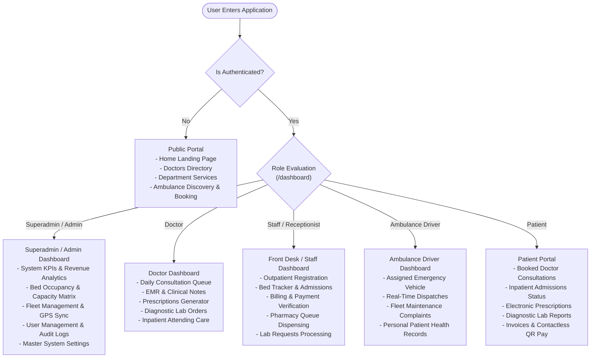
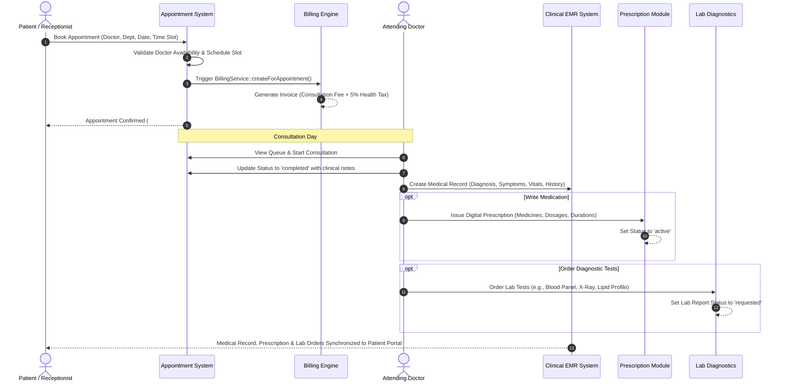
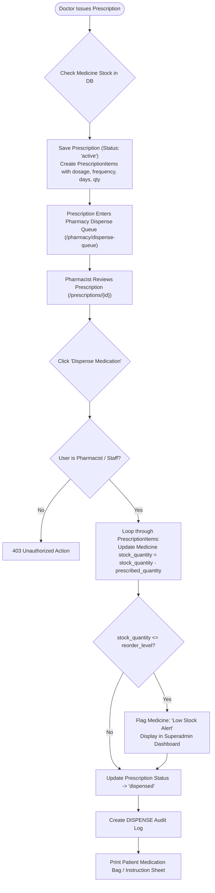
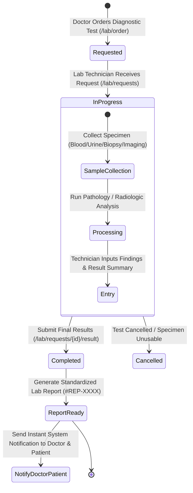
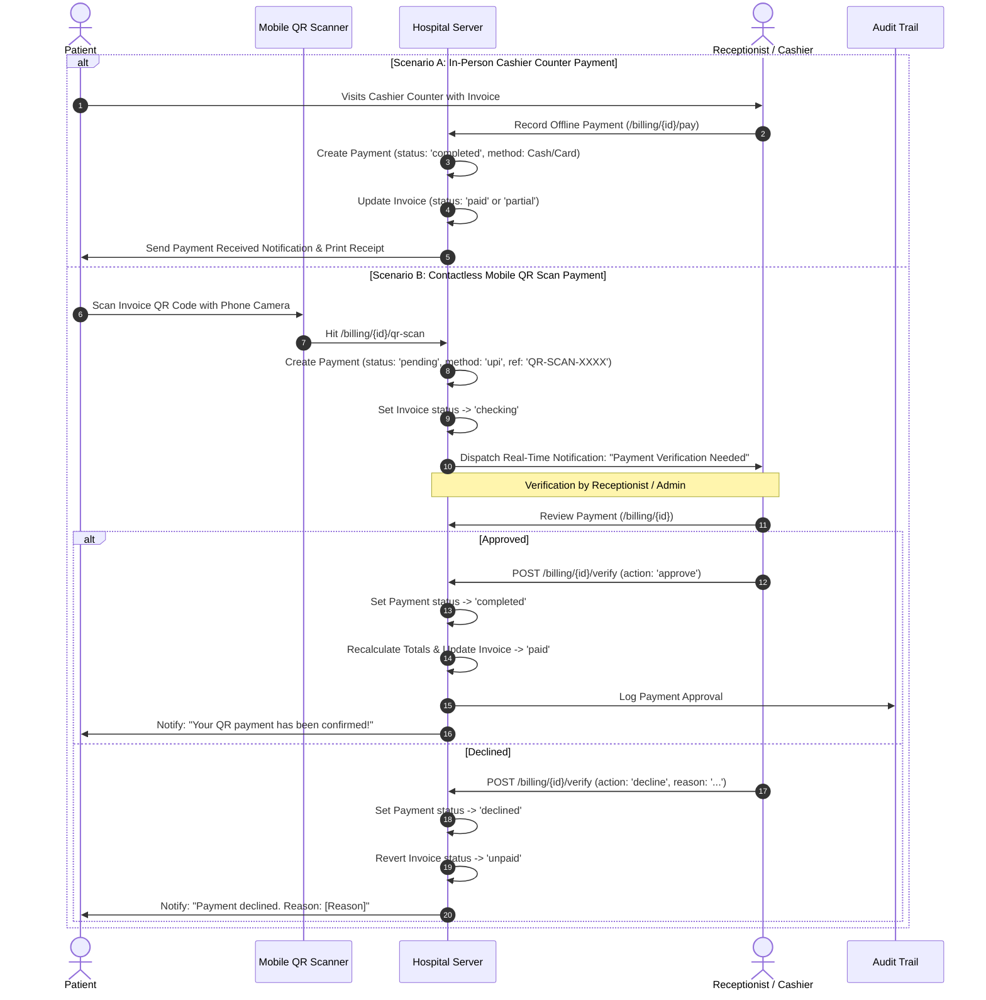
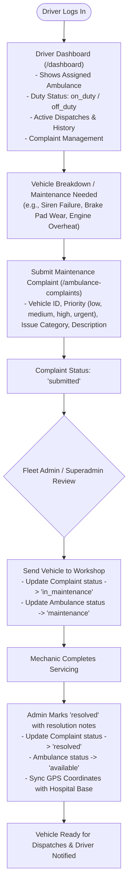
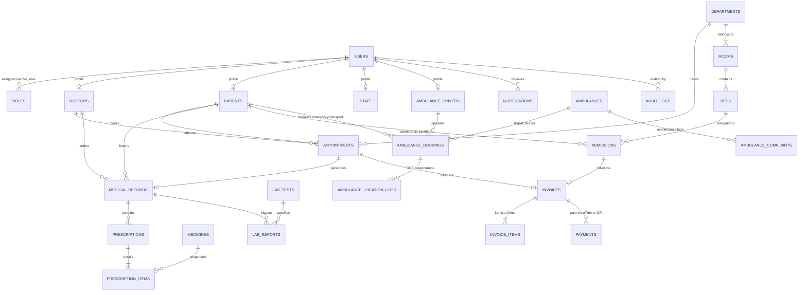

# 🏥 Apex Horizon Hospital Management System - Complete Architectural & Operational Flowcharts

This document provides a comprehensive, fully functional flowchart and process-flow breakdown of the **Apex Horizon Medical Center** platform (built on Laravel 11 with multi-role RBAC, EMR, Inpatient ADT, Emergency Ambulance Fleet with GPS tracking, Pharmacy, Diagnostics, and Contactless QR Payments).

---

## 📑 Table of Contents
1. [High-Level System Architecture & User Roles](#1-high-level-system-architecture--user-roles)
2. [Authentication, Authorization & Password Recovery (OTP) Flow](#2-authentication-authorization--password-recovery-otp-flow)
3. [Outpatient Consultation & Patient EMR Lifecycle](#3-outpatient-consultation--patient-emr-lifecycle)
4. [Inpatient Bed Management & ADT Flow (Admission, Transfer & Discharge)](#4-inpatient-bed-management--adt-flow-admission-transfer--discharge)
5. [Emergency Ambulance Booking & Live GPS Tracking Flow](#5-emergency-ambulance-booking--live-gps-tracking-flow)
6. [Pharmacy Inventory & Medication Dispensing Flow](#6-pharmacy-inventory--medication-dispensing-flow)
7. [Diagnostic Laboratory & Pathology Workflow](#7-diagnostic-laboratory--pathology-workflow)
8. [Billing, Contactless QR Payments & Cashier Verification Flow](#8-billing-contactless-qr-payments--cashier-verification-flow)
9. [Driver Duty & Ambulance Maintenance Complaint Flow](#9-driver-duty--ambulance-maintenance-complaint-flow)
10. [End-to-End Cross-Module Entity Relationship Flow](#10-end-to-end-cross-module-entity-relationship-flow)

---

## 1. High-Level System Architecture & User Roles

The system is organized around Role-Based Access Control (RBAC) where each user role has distinct permissions, workflows, and automated dashboard redirections.

---

## 2. Authentication, Authorization & Password Recovery (OTP) Flow

Includes standard credential login, role-specific demo logins, registration, and a secure 6-digit OTP verification password recovery mechanism.

```mermaid
flowchart TD
    subgraph LoginFlow["Authentication & Session Flow"]
        Start([User visits /login]) --> Choice{Login Method}
        Choice -->|Standard Login| EnterCreds["Enter Email & Password"]
        Choice -->|One-Click Demo| PickRole["Select Demo Role\n(superadmin, doctor, staff, patient, driver)"]

        EnterCreds --> Authenticate{Valid Credentials?}
        PickRole --> AutoAuth["Authenticate Predefined Demo User"]

        Authenticate -- No --> LoginFail["Show Error Alert\n(Redirect back with errors)"]
        Authenticate -- Yes --> SessionInit["Create Session & Cast Active Role"]
        AutoAuth --> SessionInit

        SessionInit --> RouteRedirect["Redirect to /dashboard (Role Router)"]
    end

    subgraph OTPFlow["Forgot Password & 6-Digit OTP Flow"]
        ForgotStart([Click 'Forgot Password']) --> EmailInput["Input Registered Email (/forgot-password)"]
        EmailInput --> ValidateEmail{Email exists in DB?}
        ValidateEmail -- No --> ReturnErr["Display 'Email not found'"]
        ValidateEmail -- Yes --> GenOTP["Generate 6-Digit Numeric OTP (100000 - 999999)"]

        GenOTP --> StoreOTP["Store in password_reset_tokens\n(Hijack token column, save timestamp)"]
        StoreOTP --> SendMail["Send Plaintext Email via Mail::raw\n(Subject: Password Reset OTP)"]
        SendMail --> RedirectOTP["Redirect to /verify-otp\n(Set session reset_email)"]

        RedirectOTP --> UserSubmitsOTP["User Enters 6-Digit OTP"]
        UserSubmitsOTP --> CheckOTP{Matches Database?}
        CheckOTP -- No --> OTPError["Invalid Code. Try Again."]
        CheckOTP -- Yes --> CheckExpiry{"Created within <= 10 mins?"}

        CheckExpiry -- No --> Expired["Delete Token & Show 'OTP Expired'"]
        CheckExpiry -- Yes --> RedirectReset["Redirect to /reset-password\n(Carry reset_email session)"]

        RedirectReset --> TypeNewPass["Enter New Password & Confirmation"]
        TypeNewPass --> UpdateHash["Hash Password (Bcrypt) & Update users table"]
        UpdateHash --> CleanTokens["Purge password_reset_tokens"]
        CleanTokens --> SuccessLogin["Redirect to /login with Success Banner"]
    end
```

---

## 3. Outpatient Consultation & Patient EMR Lifecycle

Outpatient care connects public requests, front-desk scheduling, doctor consultations, electronic medical records (EMR), prescription writing, and automatic billing invoice creation.

---

## 4. Inpatient Bed Management & ADT Flow (Admission, Transfer & Discharge)

The Admission, Discharge, and Transfer (ADT) engine manages hospital rooms, beds, and real-time clinical state transitions with strict role authorizations.

```mermaid
flowchart TD
    subgraph BedStates["Bed State Life-Cycle"]
        B_Avail[Available Bed]
        B_Occ[Occupied Bed]
        B_Clean[Cleaning / Sanitization]
        B_Maint[Maintenance]

        B_Avail -->|Patient Admitted| B_Occ
        B_Occ -->|Patient Discharged / Switched| B_Clean
        B_Clean -->|Housekeeping Marks Clean| B_Avail
        B_Avail -->|Equipment Breakdown| B_Maint
        B_Maint -->|Repaired| B_Avail
    end

    subgraph AdmissionWorkflow["Inpatient ADT Operations"]
        AdmitReq([Admit Patient Request]) --> CheckBed{Is Target Bed Available?}
        CheckBed -- No --> PickOther["Select Alternative Available Bed"]
        CheckBed -- Yes --> CreateAdmission["Create Admission Record (Status: admitted)\n- Assign Attending Physician\n- Record Room & Bed ID\n- Start Admission Clock"]
        CreateAdmission --> SetBedOcc["Update Bed status to 'occupied'"]

        SetBedOcc --> InpatientStay{"Inpatient Stay Actions"}

        InpatientStay -->|Transfer Bed Request| CheckTransferAuth{"Authorized?\n(Attending Doctor / Admin / Receptionist)"}
        CheckTransferAuth -- Yes --> ValidateNewBed{Target Bed Available?}
        ValidateNewBed -- Yes --> DoTransfer["1. Old Bed -> 'cleaning'\n2. New Bed -> 'occupied'\n3. Update Admission bed_id\n4. Append Bed Switch Audit Note\n5. Notify Patient"]

        InpatientStay -->|Discharge Request| CheckDischargeAuth{"Authorized?\n(Attending Doctor / Admin / Receptionist)"}
        CheckDischargeAuth -- Yes --> CompleteDischarge["1. Set Admission status -> 'discharged'\n2. Record discharge_date & doctor discharge_notes\n3. Release Bed -> status 'cleaning'\n4. Trigger BillingService::createForAdmission()"]

        CompleteDischarge --> GenInpatientInvoice["Generate Inpatient Invoice:\n- Daily Room Rate x Days\n- Attending Physician Fee\n- 5% Health Care Tax"]
        GenInpatientInvoice --> NotifyPatientDischarge["Send Discharge Notification to Patient"]
    end
```

---

## 5. Emergency Ambulance Booking & Live GPS Tracking Flow

Patients or staff can locate the nearest ambulance on a live interactive map, dispatch emergency transport, and track the vehicle in real-time with simulated GPS waypoints.

```mermaid
flowchart TD
    StartAmbulance([User Opens /ambulance]) --> GetLocation["Detect User Device GPS\n(or Default to Apex Horizon Coordinates)"]
    GetLocation --> FetchFleet["Query Fleet Ambulances & Filter by Distance / Radius"]
    FetchFleet --> DisplayMap["Render Interactive Map with Leaflet / OpenStreetMap\n- Available, Dispatched, In-Transit, Maintenance Markers"]

    DisplayMap --> ClickBook["Submit Booking (/ambulance/book)\n- Input Contact Phone, Address, Destination Dept\n- Auto-Detect or Manual GPS Coordinates"]
    
    ClickBook --> DispatchEngine{"Ambulance Selection"}
    DispatchEngine -->|Specific Ambulance Chosen| VerifyAvailable{Is Vehicle Available?}
    DispatchEngine -->|No Preference| FindNearest["Run Haversine Distance Calculation\nFind Nearest Available Ambulance"]

    VerifyAvailable -- No --> FindNearest
    FindNearest --> AnyAvailable{Any Ambulance Available?}
    AnyAvailable -- No --> Alert911["Display Alert: All Units Busy.\nAdvise calling emergency 911."]
    
    AnyAvailable -- Yes --> CreateBooking["Create AmbulanceBooking Record:\n- Status: 'assigned'\n- Link Patient & Assigned Driver\n- Destination Dept (Default: Emergency)"]
    CreateBooking --> UpdateVehicle["Update Ambulance status -> 'dispatched'\nLog First GPS Coordinate in ambulance_location_logs"]
    UpdateVehicle --> RedirectLiveTrack["Redirect to Live Tracking Screen (/ambulance/track/{id})"]

    subgraph LiveTracking["Real-Time Tracking & Simulation Loop"]
        RedirectLiveTrack --> LoadTrackUI["Render Zomato-Style Live Tracking UI\n- Live Vehicle Marker, Patient Marker, Hospital Marker\n- ETA Countdown & Real-Time Status Badge\n- Driver Contact & Vehicle Details"]
        
        LoadTrackUI --> PollPosition["Client Polling / SSE: /ambulance/api/track/{id}"]
        PollPosition --> MovementSim["Driver/Admin GPS Simulation Step:\n/ambulance/api/simulate-step/{id}"]
        
        MovementSim --> CalcStep["Interpolate Waypoint towards Pickup / Hospital\nUpdate current_latitude & current_longitude\nLog Breadcrumb in ambulance_location_logs"]
        CalcStep --> CheckArrive{Arrived at Destination?}
        
        CheckArrive -- No --> PollPosition
        CheckArrive -- Yes --> CompleteTrip["Set Booking status -> 'completed'\nSet Ambulance status -> 'available'\nCreate Trip Audit Log"]
    end
```

---

## 6. Pharmacy Inventory & Medication Dispensing Flow

Doctors issue digital prescriptions that flow directly into the pharmacy queue. Pharmacists dispense medication, automatically decrementing physical inventory and alerting low-stock levels.

---

## 7. Diagnostic Laboratory & Pathology Workflow

Diagnostic test orders progress from initial doctor request to laboratory specimen collection, testing, result recording, and instant reporting.

---

## 8. Billing, Contactless QR Payments & Cashier Verification Flow

Supports both traditional front-desk cashier payments and modern mobile camera contactless QR scan payments with two-step receptionist verification.

---

## 9. Driver Duty & Ambulance Maintenance Complaint Flow

Drivers monitor their dispatched vehicles and file maintenance or mechanical complaints that transition through maintenance lifecycle states.

---

## 10. End-to-End Cross-Module Entity Relationship Flow

How core database entities interact throughout a patient's lifecycle in the hospital ecosystem:

---

## 🚀 Summary of Key Technical Highlights
- **Framework**: Laravel 11 with Eloquent ORM & Blade Templates.
- **Dynamic Dashboards**: Centralized routing in `DashboardController` directing each user to customized interfaces.
- **Audit Logging**: Comprehensive activity tracking via `AuditService::log()` across every clinical, financial, and operational event.
- **Real-Time Simulation**: API-driven vehicle movement simulation with Haversine distance computations and breadcrumb logging.
- **Contactless QR Verification**: Asynchronous two-step payment workflow bridging patient mobile scanning with front-desk cashier approvals.
