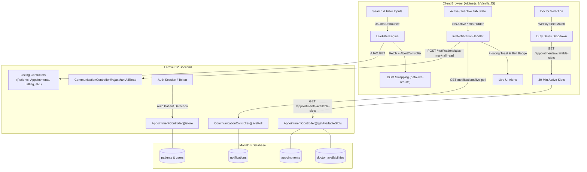
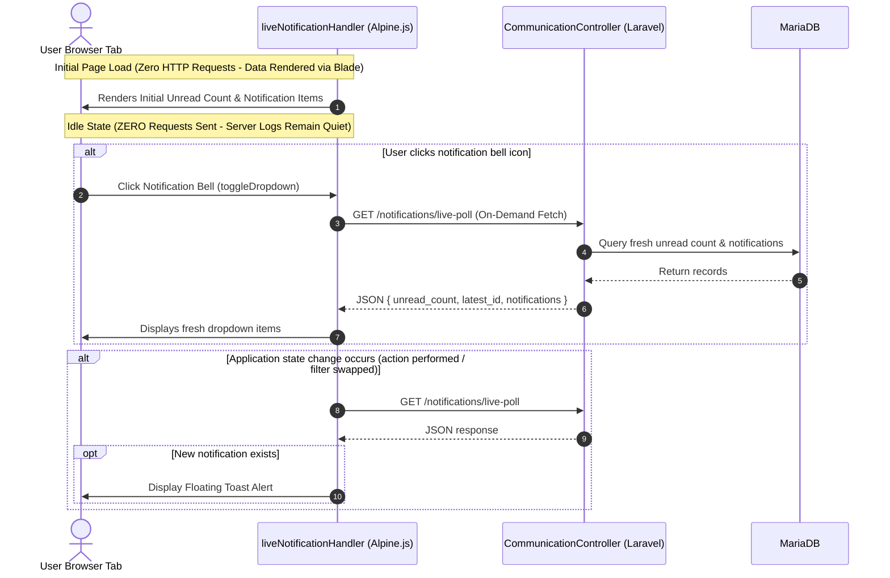

# Technical Implementation Guide: Real-Time Interactions, Activity-Aware Notifications & Schedule-Driven Appointments

This document provides a detailed technical breakdown of the architecture, controller methods, routes, frontend engines, and UI enhancements implemented across the hospital management platform.

---

## 1. System Architecture Overview

---

## 2. Universal Live Search & Filter Engine (Zero Page Reloads)

### Problem Addressed
Previously, every text keystroke in search inputs, every dropdown selection (departments, doctors, status, gender, blood type), and every pagination or filter reset triggered a standard browser GET submission (`document.forms[0].submit()`), reloading the entire document and discarding client state.

### Solution & Technical Mechanics
A global client engine ([`LiveFilterEngine`](file:///c:/xampp/htdocs/hospital/resources/views/layouts/app.blade.php#L985)) was developed and injected into the core layout ([`layouts/app.blade.php`](file:///c:/xampp/htdocs/hospital/resources/views/layouts/app.blade.php)) and public layout ([`layouts/public.blade.php`](file:///c:/xampp/htdocs/hospital/resources/views/layouts/public.blade.php)).

#### Key Engine Features:
1. **Debounced Real-Time Typing (350ms)**:
   - Listens to `input` events on `<input type="text">` and `<input type="search">`.
   - Postpones execution until the user stops typing for 350ms, eliminating request storms and server overload.
2. **Instant Select & Date Detection**:
   - Listens to `change` events on `<select>`, `<input type="date">`, checkboxes, and radio buttons, firing an immediate fetch.
3. **In-Flight Cancellation (`AbortController`)**:
   - When a user continues typing or changes filters before the previous request finishes, the previous fetch is instantly aborted via `AbortController.abort()`, preventing race conditions.
4. **Non-Destructive Container Swapping**:
   - Fetches the filtered HTML via background `fetch(..., { headers: { 'X-Requested-With': 'XMLHttpRequest' } })`.
   - Parses the returned DOM with `DOMParser`.
   - Replaces only the matching results container (`[data-live-results]`), table wrapper (`.overflow-x-auto`), or filter badges (`[data-live-reset-container]`, `[data-live-nav]`).
   - The search input remains focused, ensuring cursor position is never lost.
5. **History & Navigation Sync**:
   - Updates the browser address bar with `window.history.pushState(null, '', targetUrl)` so that bookmarks, shareable links, and browser Back/Forward navigation remain functional.
   - Listens to `popstate` to restore previous filter states seamlessly.
6. **Pagination Interception**:
   - Intercepts clicks on Laravel pagination links (`.pagination a`, `nav[role="navigation"] a`), loading target pages without full reloads.

#### Implementation Locations:
- **Core Engine Script**: [layouts/app.blade.php lines 985–1110](file:///c:/xampp/htdocs/hospital/resources/views/layouts/app.blade.php#L985)
- **Public Engine Script**: [layouts/public.blade.php lines 173–247](file:///c:/xampp/htdocs/hospital/resources/views/layouts/public.blade.php#L173)
- **Target Containers Added**:
  - `data-live-results` on [appointments/index.blade.php](file:///c:/xampp/htdocs/hospital/resources/views/appointments/index.blade.php#L70)
  - `data-live-results` on [patients/index.blade.php](file:///c:/xampp/htdocs/hospital/resources/views/patients/index.blade.php#L54)
  - `data-live-results` on [billing/index.blade.php](file:///c:/xampp/htdocs/hospital/resources/views/billing/index.blade.php#L314)
  - `data-live-results` on [facilities/bed-tracker.blade.php](file:///c:/xampp/htdocs/hospital/resources/views/facilities/bed-tracker.blade.php#L135)
  - `data-live-results` on [prescriptions/index.blade.php](file:///c:/xampp/htdocs/hospital/resources/views/prescriptions/index.blade.php#L29)
  - `data-live-results` on [medical-records/index.blade.php](file:///c:/xampp/htdocs/hospital/resources/views/medical-records/index.blade.php#L30)
  - `data-live-results` on [lab/requests.blade.php](file:///c:/xampp/htdocs/hospital/resources/views/lab/requests.blade.php#L34)
  - `data-live-results` on [pharmacy/index.blade.php](file:///c:/xampp/htdocs/hospital/resources/views/pharmacy/index.blade.php#L103)
  - `data-live-results` on [admin/users/index.blade.php](file:///c:/xampp/htdocs/hospital/resources/views/admin/users/index.blade.php#L47)
  - `data-live-results` on [admin/audit-logs/index.blade.php](file:///c:/xampp/htdocs/hospital/resources/views/admin/audit-logs/index.blade.php#L42)
  - `data-live-results` on [public/doctors.blade.php](file:///c:/xampp/htdocs/hospital/resources/views/public/doctors.blade.php#L51)

---

## 3. Real-Time Notifications: Event-Driven & On-Demand (Zero Background Polling Spam)

### Problem Addressed & Constraints
1. Notifications were rendered statically via Blade. New messages, admission notices, or test results were invisible until a user refreshed the page.
2. Clicking "Mark all read" caused a full-page reload.
3. Explicit user requirement: **Do NOT send rapid or continuous periodic background requests to the API when idle.** Only query when actual changes occur or on explicit user action.

### Solution & Technical Mechanics
An event-driven Alpine.js reactive component ([`liveNotificationHandler`](file:///c:/xampp/htdocs/hospital/resources/views/layouts/app.blade.php#L903)) backed by lightweight dedicated JSON endpoints was implemented.

#### Zero-Polling Strategy:
- **No Background Loops**: All `setInterval`, `setTimeout`, and `scheduleNextPoll` timer loops were completely removed.
- **On-Demand Fetch**: When the user clicks the notification bell icon (`toggleDropdown()`), the dropdown opens and fetches fresh data on demand.
- **Action-Triggered Updates**: When user actions or page updates occur (`hospital-state-change` event), the component refreshes once.
- **Cross-Tab Sync**: Uses `window.addEventListener('storage')` to notify other browser tabs without querying the server on a timer.

#### Real-Time Floating Toast Alert:
- When a new notification arrives (`data.latest_id > this.lastSeenId`), a toast pops up in the bottom-right corner with the notification's title, body snippet, an **Open** button pointing to `n.target_url`, and a **Dismiss** button.
- Automatically dismisses after 6 seconds if not manually closed.

#### Backend Endpoints & Methods in [`CommunicationController.php`](file:///c:/xampp/htdocs/hospital/app/Http/Controllers/CommunicationController.php):
1. **`livePoll(Request $request)`**:
   - Route: `GET /notifications/live-poll` &rarr; `communication.notifications.live-poll`
   - Returns unread count, highest notification ID (`latest_id`), and top 6 unread items with human-readable timestamps (`diffForHumans()`).
2. **`ajaxMarkAllRead()`**:
   - Route: `POST /notifications/ajax-mark-all-read` &rarr; `communication.notifications.ajaxMarkAllRead`
   - Sets all unread notifications for `Auth::id()` to `is_read = true` without reloading the page.
3. **`ajaxMarkRead($id)`**:
   - Route: `POST /notifications/{id}/ajax-mark-read` &rarr; `communication.notifications.ajaxMarkRead`
   - Marks a single notification as read upon user interaction.

---

## 4. Appointment Booking: Doctor Schedule Filtering & Auto-Detected Patient

### Problem Addressed
1. The appointment booking page displayed a manual `<select name="patient_id">` dropdown.
2. The appointment date input allowed picking any date, regardless of whether the doctor worked that day.
3. The time slot selector was a hardcoded static list (`09:00 AM` to `04:30 PM`) that did not reflect the doctor's roster or subtract existing patient bookings.

### Solution & Technical Mechanics

#### 1. Patient Auto-Detection:
- In [appointments/create.blade.php](file:///c:/xampp/htdocs/hospital/resources/views/appointments/create.blade.php#L21-L47), the `<select name="patient_id">` was completely removed.
- Replaced with a verified identity card displaying the patient's full name, UPI code, phone, email, and a hidden field `<input type="hidden" name="patient_id" value="{{ $patient->id }}">`.
- In [`AppointmentController::create`](file:///c:/xampp/htdocs/hospital/app/Http/Controllers/AppointmentController.php#L51) and [`AppointmentController::store`](file:///c:/xampp/htdocs/hospital/app/Http/Controllers/AppointmentController.php#L182):
  - Automatically resolves `$patient` from `Auth::user()->patient`.
  - If null, matches by `user_id` or `email`.
  - If still null (e.g. fresh registration), dynamically creates a patient record on the fly so the user is never blocked.

#### 2. Schedule-Driven Available Dates:
- In Alpine.js (`appointmentScheduler()`), each doctor's active weekly roster (`availabilities: [{ day, isAvailable, start, end }]`) is loaded.
- When a doctor is selected, the engine checks the next 35 calendar days and filters **only those calendar days that match the doctor's working days** (`isAvailable = true`).
- The date dropdown only lists valid working dates (e.g., `Monday, Nov 02, 2026 • 09:00 - 17:00`).

#### 3. Real-Time 30-Minute Time Slot Generation & Collision Checking:
- Added endpoint `GET /appointments/available-slots` mapped to [`AppointmentController::getAvailableSlots`](file:///c:/xampp/htdocs/hospital/app/Http/Controllers/AppointmentController.php#L94).
- Given `doctor_id` and `date`:
  1. Finds the doctor's duty hours for that weekday (`start_time` and `end_time`).
  2. Queries existing bookings on that date: `Appointment::where('doctor_id', $id)->whereDate('appointment_date', $date)->whereIn('status', ['scheduled', 'completed'])`.
  3. Slices the duty window into 30-minute intervals (`09:00 AM - 09:30 AM`, `09:30 AM - 10:00 AM`, etc.).
  4. Marks already-booked slots as `is_available: false` and `status: 'booked'`.
  5. Returns JSON with active slots and available count.
- In [appointments/create.blade.php](file:///c:/xampp/htdocs/hospital/resources/views/appointments/create.blade.php#L107-L135), changing the date calls `fetchSlots()`, populating the time slot selector with available slots only and disabling booked ones.
- In [`AppointmentController::store`](file:///c:/xampp/htdocs/hospital/app/Http/Controllers/AppointmentController.php#L182), backend validation double-checks that the doctor is on duty and that the chosen slot is not occupied before inserting the record.

#### 4. Direct Booking Entry from Doctor Roster:
- In [doctors/schedule.blade.php](file:///c:/xampp/htdocs/hospital/resources/views/doctors/schedule.blade.php#L32), added a direct **"Book Appointment"** button next to the doctor's roster title that redirects to `/appointments/create?doctor_id={{ $doctor->id }}` with that physician pre-selected.

---

## 5. Bed Tracker UI Card Layout Fix

### Problem Addressed
In [bed-tracker.blade.php](file:///c:/xampp/htdocs/hospital/resources/views/facilities/bed-tracker.blade.php), occupied bed cards placed action buttons in a horizontal 2-column grid (`grid grid-cols-2`). In narrow room card layouts (`xl:grid-cols-4`), the `Switch` and `Disch.` buttons overlapped and collided horizontally.

### Solution
- In [facilities/bed-tracker.blade.php line 265](file:///c:/xampp/htdocs/hospital/resources/views/facilities/bed-tracker.blade.php#L265):
  - Changed `
` to `
` so buttons stack vertically ("one after another") at full width.
  - Added `whitespace-nowrap` to `Bed #{{ $bed->bed_number }}` and `shrink-0` to the status dot to prevent text breaking into two lines.
  - Adjusted bed card minimum height (`min-h-[145px]`) and room scroll container height (`max-h-[340px]`) so up to 4 beds display comfortably before scrolling.

---

## 6. Complete File & Method Audit Matrix

| File Path | Component / Layer | Methods / Additions | Purpose |
| :--- | :--- | :--- | :--- |
| [`routes/web.php`](file:///c:/xampp/htdocs/hospital/routes/web.php) | Routing | `GET /appointments/available-slots` `GET /notifications/live-poll` `POST /notifications/ajax-mark-all-read` `POST /notifications/{id}/ajax-mark-read` | Registers API endpoints for dynamic slot checking and notification polling. |
| [`app/Http/Controllers/AppointmentController.php`](file:///c:/xampp/htdocs/hospital/app/Http/Controllers/AppointmentController.php) | Backend Controller | `create()` `store()` `getAvailableSlots()` | Auto-resolves patient identity, calculates 30-min duty slots minus booked appointments, and validates booking requests. |
| [`app/Http/Controllers/CommunicationController.php`](file:///c:/xampp/htdocs/hospital/app/Http/Controllers/CommunicationController.php) | Backend Controller | `livePoll()` `ajaxMarkAllRead()` `ajaxMarkRead()` | Returns real-time unread counts and recent notifications via JSON; marks alerts read asynchronously. |
| [`resources/views/layouts/app.blade.php`](file:///c:/xampp/htdocs/hospital/resources/views/layouts/app.blade.php) | Core Layout | `liveNotificationHandler()` `LiveFilterEngine` | Houses the activity-aware notification poller, floating alert toast, and universal debounced live search & filter engine. |
| [`resources/views/layouts/public.blade.php`](file:///c:/xampp/htdocs/hospital/resources/views/layouts/public.blade.php) | Public Layout | `LiveFilterEngine (vanilla)` | Enables real-time debounced filtering across public pages without page reloads. |
| [`resources/views/appointments/create.blade.php`](file:///c:/xampp/htdocs/hospital/resources/views/appointments/create.blade.php) | View / Frontend | `appointmentScheduler()` | Eliminates patient select dropdown, filters dates to doctor duty days, and dynamically populates available time slots. |
| [`resources/views/doctors/schedule.blade.php`](file:///c:/xampp/htdocs/hospital/resources/views/doctors/schedule.blade.php) | View / Frontend | Roster Header & Action | Adds direct "Book Appointment" link targeting the scheduling form for the viewed doctor. |
| [`resources/views/facilities/bed-tracker.blade.php`](file:///c:/xampp/htdocs/hospital/resources/views/facilities/bed-tracker.blade.php) | View / Frontend | Bed Card Actions | Stacks Transfer and Discharge buttons vertically ("one after another") and prevents bed number text wrapping. |
| `resources/views/{patients,appointments,billing,...}/index.blade.php` | Views / Frontend | `data-live-results` `data-live-nav` `data-live-reset` | Hooks table and grid containers into the universal live engine for asynchronous updates. |

