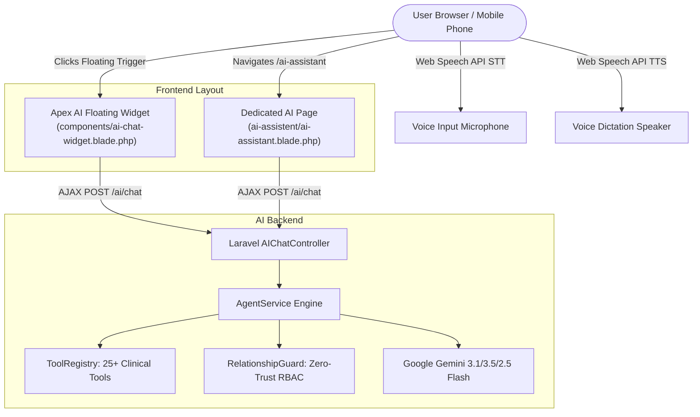

# Hospital AI Assistant — Complete Implementation Guide

This guide documents the technical implementation of the autonomous **Apex Horizon AI Assistant**, the frontend chat interfaces, real-time voice interaction (Microphone STT & Speaker TTS), and the secure mobile port-forwarding setup.

---

## 1. Architectural Overview & UI Design

The application features two complementary interfaces for interacting with the AI:



### 1.1 The Two Interfaces

| Feature | Floating Chat Widget | Full-Page AI Assistant |
| :--- | :--- | :--- |
| **Blade Template** | [`resources/views/components/ai-chat-widget.blade.php`](file:///c:/xampp/htdocs/hospital/resources/views/components/ai-chat-widget.blade.php) | [`resources/views/ai-assistent/ai-assistant.blade.php`](file:///c:/xampp/htdocs/hospital/resources/views/ai-assistent/ai-assistant.blade.php) |
| **Trigger / Location** | Floating bottom-right gradient launcher with pulsing ring | Route `/ai-assistant` via sidebar navigation |
| **Display Mode** | Slides open as a responsive modal (`460px` desktop, full-width on mobile) | Full desktop shell with navigation sidebar and topic cards |
| **Presence** | Global across all authenticated views (except `/ai-assistant`) | Standalone dedicated full-screen workspace |
| **Backend** | Real-time AJAX to `POST /ai/chat` | Real-time AJAX to `POST /ai/chat` |
| **Voice Support** | Integrated Mic STT + Speaker TTS | Integrated Mic STT + Speaker TTS |

---

## 2. Fixing the Git Merge Conflict

### The Problem
During an interactive rebase or merge of commit `afc0cce` (*"added rag system to automate the site"*), unresolved Git conflict markers were accidentally committed into [`resources/views/layouts/app.blade.php`](file:///c:/xampp/htdocs/hospital/resources/views/layouts/app.blade.php):

```blade
<<<<<<< HEAD
        </main>
    </div>
=======
    @include('components.ai-chat-widget')
>>>>>>> afc0cce (added rag system to automate the site)
```

Because PHP/Blade treats Git conflict markers as raw text, the browser rendered the literal string:
```text
=======
Apex AI
Hospital Assistant
Patient
>>>>>>> afc0cce (added rag system to automate the site)
```
Between the `=======` and `>>>>>>>` markers, `@include('components.ai-chat-widget')` was executed, outputting the Apex AI button labels (`Apex AI`, `Hospital Assistant`, `Patient`).

### The Solution
1. Stripped all conflict markers (`<<<<<<< HEAD`, `=======`, `>>>>>>> ...`).
2. Properly closed the main layout containers (`</main>` and `</div>`).
3. Cleaned out duplicate/obsolete `#ai-chat-launcher` styling from `app.blade.php`.
4. Embedded `@include('components.ai-chat-widget')` cleanly right after the layout wrapper.
5. Cleared compiled Blade views with `php artisan view:clear`.

---

## 3. Real-Time Voice Input (Speech-to-Text / STT)

The microphone button allows users to talk to the AI naturally instead of typing.

### 3.1 Technology: Web Speech Recognition API
Modern browsers provide the `SpeechRecognition` (or `webkitSpeechRecognition`) API.

```javascript
const SpeechRecClass = window.SpeechRecognition || window.webkitSpeechRecognition;
if (SpeechRecClass) {
    recognition = new SpeechRecClass();
    recognition.continuous = false;    // Stops when user pauses
    recognition.interimResults = true; // Displays live transcription as user speaks
    recognition.lang = 'en-US';
}
```

### 3.2 Workflow & State Management

1. **User Clicks Microphone (`#apex-ai-mic-btn`):**
   - Cancels any running text-to-speech dictation (`apexAiStopSpeaking()`).
   - Starts audio capture (`recognition.start()`).
   - Button turns pulsating red with an animated wave/stop icon (`animate-pulse bg-rose-600 text-white`).
   - Displays a banner: `🎙️ Listening... Speak into your microphone`.

2. **Interim Transcription (`onresult`):**
   - As the user speaks, interim text is dynamically written to the input field (`#apex-ai-input`).
   - The user visually sees their words appear in real time.

3. **Hands-Free Submission (`onend`):**
   - When the user stops talking (natural speech pause) or clicks the Stop button:
   - The microphone UI returns to normal.
   - If transcript text exists, the form automatically submits (`apexAiSubmitMessage(new Event('submit'))`).
   - This provides a **completely hands-free conversational loop**.

4. **Error Handling (`onerror`):**
   - Detects `not-allowed` errors (when browser denies microphone permissions) and provides a helpful alert explaining how to allow permissions.

---

## 4. Voice Dictation (Text-to-Speech / TTS Speaker Toggle)

The user requested an option where generated AI texts are dictated through the speaker if activated, or shown only as silent chat if deactivated.

### 4.1 Technology: Web Speech Synthesis API
Browsers natively provide `window.speechSynthesis` and `SpeechSynthesisUtterance`.

### 4.2 Dictation Logic & Natural Sound Preprocessing

Before passing the AI response to the speech synthesizer, raw markdown must be cleaned up so the voice sounds natural:

```javascript
function apexAiSpeak(rawText) {
    if (!apexAiSpeakerActive || !('speechSynthesis' in window)) return;

    window.speechSynthesis.cancel(); // Interrupt previous speech

    // Clean markdown tokens so they are not read literally
    let speakable = rawText
        .replace(/```[\s\S]*?```/g, '')     // Strip code blocks
        .replace(/`([^`]+)`/g, '$1')         // Strip inline code backticks
        .replace(/\*\*([^*]+)\*\*/g, '$1')   // Strip bold markers
        .replace(/\*([^*]+)\*/g, '$1')       // Strip italic markers
        .replace(/#+\s*/g, '')               // Strip headings
        .replace(/https?:\/\/\S+/g, '')      // Strip raw URLs
        .replace(/[•\-\*]\s+/g, ', ')        // Convert bullets to natural pauses
        .replace(/<[^>]*>/g, '')             // Strip HTML tags
        .replace(/\s+/g, ' ')
        .trim();

    if (!speakable) return;

    const utterance = new SpeechSynthesisUtterance(speakable);
    utterance.rate = 1.0;
    utterance.pitch = 1.0;
    utterance.lang = 'en-US';

    // Prioritize natural/Google/English voices
    const voices = window.speechSynthesis.getVoices();
    if (voices.length > 0) {
        const preferred = voices.find(v => 
            v.lang.startsWith('en') && 
            (v.name.includes('Natural') || v.name.includes('Google') || v.name.includes('Samantha') || v.name.includes('English'))
        );
        if (preferred) utterance.voice = preferred;
    }

    // Display banner while speaking with a quick "Stop Voice" button
    const banner = document.getElementById('apex-ai-speaking-banner');
    utterance.onstart = () => { if (banner) banner.style.display = 'flex'; };
    utterance.onend   = () => { if (banner) banner.style.display = 'none'; };
    utterance.onerror = () => { if (banner) banner.style.display = 'none'; };

    window.speechSynthesis.speak(utterance);
}
```

### 4.3 Persistent Speaker Toggle Mode

- **Toggle Controls:** Located in both the window header and footer:
  - **Voice ON (🔊):** Generated AI response is spoken aloud through the speaker **and** displayed in chat.
  - **Voice Muted (🔇):** Generated AI response is displayed **only in chat** (no audio).
- **Storage:** Persisted in `localStorage.getItem('apex_ai_voice_dictation')` so preferences survive page reloads and navigations.
- **Instant Interruption:** Clicking **Stop Voice**, typing a new prompt, or clicking the microphone immediately halts active speech.

---

## 5. Port Forwarding & Mobile Testing Setup

To test the hospital system on a mobile phone (Android or iPhone):

### 5.1 Why an HTTPS Tunnel is Required for Voice

> [!IMPORTANT]
> **Mobile Browser Security Requirement:**
> Mobile Chrome (Android) and Safari (iOS) strictly enforce that `getUserMedia()` and the `SpeechRecognition` API **can only run under secure origins (HTTPS or localhost)**.
> Accessing a local IP like `http://192.168.1.10:8000` over plain HTTP blocks microphone access. A TLS-terminated tunnel (`https://...`) satisfies this requirement completely.

### 5.2 SSH TLS Tunnel via `localhost.run`

An outbound reverse tunnel forwards the local Laravel server (`127.0.0.1:8000`) through an encrypted SSH tunnel:

```bash
ssh -o StrictHostKeyChecking=no -o ServerAliveInterval=30 -R 80:127.0.0.1:8000 nokey@localhost.run
```

- **Output Tunnel URL:** `https://97a00a7bc9d617.lhr.life`
- **SSL Certificate:** Free Let's Encrypt TLS termination handled automatically.
- **QR Code:** Generated via QR server API so mobile devices can simply scan the screen to test.

---

## 6. Verification Checklist

| Requirement | Implementation Status | Test Method |
| :--- | :--- | :--- |
| **Remove Conflict Markers** | Resolved | Verified clean HTML output in `app.blade.php` |
| **Restore Apex AI Widget** | Active | Available across all dashboard routes |
| **Microphone Button (Voice In)** | Active | Speech recognition transcribes live and auto-sends |
| **Speaker Toggle (Voice Out)** | Active | Toggles between audible dictation and chat-only |
| **Speaking Interruption** | Active | Stop button immediately cuts off speech |
| **Mobile Port Forwarding** | Active | Accessible via `https://97a00a7bc9d617.lhr.life` |
