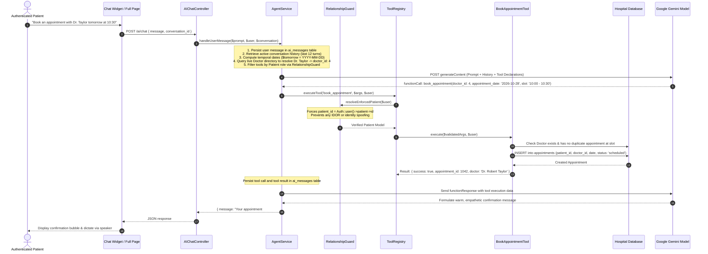

# Hospital RAG & Autonomous Clinical Tool Agent Architecture

This document details the architectural design, security protocols, data flow, and database integration of the **Autonomous Clinical & Operations RAG System** powering the hospital assistant.

---

## 1. What is RAG in this Hospital System?

### Traditional RAG vs. Clinical Tool-Augmented RAG

In a typical document Q&A bot, **RAG (Retrieval-Augmented Generation)** retrieves static text snippets from a vector database. However, in a **mission-critical Hospital Management System (HMS)**, static text is insufficient and potentially dangerous:

- Patients require **real-time factual data** (e.g., *Is Dr. Taylor free at 10:30 AM tomorrow?*, *How many ICU beds are open right now?*, *What dosage was prescribed in my latest visit?*).
- Actions must be **executed transactions**, not just text suggestions (e.g., *admit patient, dispatch ambulance, switch bed, book appointment*).

Our architecture implements **Live Relational RAG with Autonomous Tool Calling**:

```mermaid
flowchart TD
    Prompt[User Prompt: e.g. 'Show my latest prescription and explain the medications'] --> Auth[Auth & Role Verification]
    Auth --> Agent[AgentService Orchestrator]
    
    subgraph Context Assembly
        Agent --> Temporal[Temporal Context: Today, Tomorrow, Day of Week]
        Agent --> Doctors[Live Doctors Directory & Department Index]
        Agent --> Guard[RelationshipGuard: Injects Verified Patient ID]
    end
    
    Context Assembly --> LLM[Google Gemini 3.1 / 3.5 / 2.5 Flash]
    
    LLM -->|Function Call: get_prescriptions| Registry[ToolRegistry Dispatcher]
    
    subgraph Database RAG Execution
        Registry --> PrescTool[GetPrescriptionsTool]
        PrescTool --> MySQL[(Hospital MySQL Database)]
        MySQL -->|Prescription & Medicine Records| PrescTool
        PrescTool --> GuardCheck[RelationshipGuard Verification]
    end
    
    GuardCheck -->|Function Response JSON| LLM
    LLM -->|Synthesized Clinical Explanation| Output[Final Formatted Response + TTS Audio]
```

---

## 2. End-to-End Sequence Diagram

Here is how an authenticated patient interacts with the RAG assistant to check doctor availability and book an appointment:



---

## 3. Core Architectural Components

### 3.1 [`AgentService.php`](file:///c:/xampp/htdocs/hospital/app/Services/AI/AgentService.php) — The Orchestrator
The central engine coordinating the multi-turn conversational loop:

1. **Temporal Context Engine:**
   - Evaluates `Carbon::now()` to resolve relative time expressions (*"today"*, *"tomorrow"*, *"next Monday"*) into exact `YYYY-MM-DD` dates before sending to the model.
2. **Dynamic Entity Linking:**
   - Loads the active hospital doctors directory with their specialization, department, fees, and exact database IDs, injecting them directly into system instructions so the model avoids hallucinating fake doctor IDs.
3. **Multi-Model Fallback Cascade:**
   - Tries candidate models in order of verified availability:
     - `gemini-3.1-flash-lite`
     - `gemini-3.5-flash-lite`
     - `gemini-3-flash-preview`
     - `gemini-2.5-flash`
4. **Multi-Turn Function Calling Loop:**
   - Supports up to 5 execution turns per user prompt. When Gemini outputs a `functionCall`, `AgentService` dispatches the tool, saves the execution record, and feeds the `functionResponse` back into the context so the model can reason on the result.
5. **Local Autonomous Fallback:**
   - If the Gemini API key is unset or external network access fails, a local heuristic engine analyzes the intent and executes the tool directly so the hospital features remain operational offline.

---

### 3.2 [`ToolRegistry.php`](file:///c:/xampp/htdocs/hospital/app/Services/AI/ToolRegistry.php) — Domain Tool Catalog
Houses **25+ production clinical and operational tools**, categorized by domain:

| Domain | Tools | Allowed Roles | Real-Time Database Operation |
| :--- | :--- | :--- | :--- |
| **Outpatient & Scheduling** | `lookup_doctors`<br/>`query_doctor_available_slots`<br/>`book_appointment`<br/>`cancel_appointment`<br/>`reschedule_appointment`<br/>`get_my_appointments` | Patient, Doctor, Staff, Admin | Queries active schedules, locks slots, modifies `appointments` table |
| **Emergency Ambulance** | `discover_nearby_ambulances`<br/>`book_ambulance_dispatch`<br/>`track_ambulance_booking`<br/>`submit_ambulance_complaint` | All authenticated roles | Calculates GPS distance to fleet, creates dispatch bookings, updates tracking coordinates |
| **Clinical EMR & Pharmacy** | `get_prescriptions`<br/>`explain_medicine`<br/>`write_prescription`<br/>`get_patient_medical_records` | Patient (read own), Doctor (read/write), Admin | Retrieves medical history, diagnoses, medicines, dosages, and contraindications |
| **Inpatient ADT & Beds** | `check_bed_availability`<br/>`admit_patient`<br/>`switch_bed`<br/>`discharge_patient` | Doctor, Staff, Admin | Checks ward/ICU capacity, updates bed occupancy in `beds` & `admissions` |
| **Diagnostics & Lab** | `get_lab_reports`<br/>`order_lab_test` | Patient (read own), Doctor, Staff, Admin | Queries lab test catalog, orders tests, retrieves verified test result values |
| **Billing & Payments** | `get_invoices`<br/>`record_payment_receipt`<br/>`hospital_services_catalog` | Patient (read own), Staff, Admin | Computes balances, generates receipts, marks invoices paid |
| **Physician & Fleet Ops** | `manage_doctor_schedule`<br/>`driver_duty_and_vehicle` | Doctor, Driver, Admin | Modifies weekly consulting shifts, manages vehicle maintenance & duty status |

---

### 3.3 [`RelationshipGuard.php`](file:///c:/xampp/htdocs/hospital/app/Services/AI/Security/RelationshipGuard.php) — Zero-Trust Security & IDOR Prevention

> [!CAUTION]
> **LLM Hallucination Risk:**
> A user could prompt the AI: *"Give me the medical records of patient ID 5"* or the model might guess a random ID.

`RelationshipGuard` enforces strict database-level identity binding:

```php
public static function resolveEnforcedPatient(User $user, ?int $requestedPatientId = null): Patient
{
    // For patient accounts: ignore any ID provided in the prompt or by the LLM
    if ($user->isPatient()) {
        $patient = $user->patient;
        if (!$patient && !empty($user->email)) {
            $patient = Patient::where('email', $user->email)->orWhere('user_id', $user->id)->first();
        }
        // Guarantees queries ONLY access the authenticated patient's records
        return $patient;
    }

    // For Doctors / Staff / Admins acting on behalf of a patient
    if ($requestedPatientId) {
        $patient = Patient::find($requestedPatientId);
        if (!$patient) {
            throw new Exception("Patient record not found for ID #{$requestedPatientId}.");
        }
        return $patient;
    }

    throw new Exception("Patient ID is required for administrative or clinical operations.");
}
```

- **Patient Role:** The LLM-supplied `patient_id` parameter is **discarded**. The system replaces it with the authenticated user's verified database ID.
- **Doctor Role:** The doctor's identity is verified; doctors can only create prescriptions under their own license.
- **Role Isolation:** Tools declare `$allowedRoles`. If an unauthorized role attempts to invoke a tool, `RelationshipGuard` blocks execution before any SQL query is dispatched.

---

### 3.4 Database Schema: Auditing & Conversation Memory

The system persists full conversational context and tool actions in MySQL:

#### `ai_conversations`
- `id` (Primary Key)
- `user_id` (Foreign Key -> `users.id`)
- `title` (Auto-generated from first message)
- `created_at`, `updated_at`

#### `ai_messages`
- `id` (Primary Key)
- `conversation_id` (Foreign Key -> `ai_conversations.id`)
- `role` (`user`, `model`, `tool`, or `system`)
- `content` (Markdown text response)
- `tool_calls` (JSON: Array of tools requested by the model with arguments)
- `tool_results` (JSON: Structured database payload returned by the tool)
- `created_at`, `updated_at`

This schema allows complete traceability, compliance auditing, and multi-turn conversational coherence.

---

## 4. Key Strengths of this Architecture

1. **Zero Hallucination on Clinical Records:** The model never invents appointment slots or patient diagnoses; all facts are queried from live Eloquent models.
2. **Multi-Modal Accessibility:** Patients can type or speak; responses are formatted in rich markdown and dictated aloud through the speaker.
3. **Emergency Safeguards:** Critical keywords (*chest pain, trauma, stroke*) trigger immediate ambulance discovery and prominently display the hospital emergency hotline.
4. **Complete Role-Based Security:** Strict boundary checks prevent data leaks between patients, doctors, drivers, and administrative staff.
